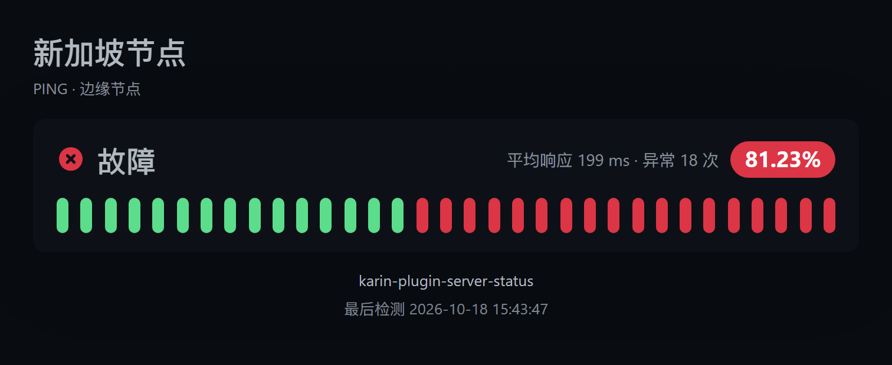

# karin-plugin-server-status（服务器状态监控）

Karin 服务器状态监控告警插件：定时轮询自部署监控面板的状态页（可选叠加面板指标接口），服务异常 / 恢复时主动推送消息，并附上一张监控状态截图。



## 功能特性

- **异常主动推送**：监控项从「正常」变为「故障」时立即推送告警。
- **恢复通知**：服务恢复后推送恢复消息，并附带本次中断时长。
- **状态截图**：告警、恢复、查询消息都会附带一张状态页风格的状态图（整体状态、分组、可用率胶囊、心跳条）。
- **面板自监控**：面板本身不可达时也会告警（连续失败 N 次后触发），恢复后再次通知。
- **重复提醒**：故障长时间未恢复时按间隔重复提醒（可关闭）。
- **状态持久化**：重启 Karin 后从上次状态继续，不会把已有的故障重新刷屏。
- **聊天指令**：随时查询整体状态、单个监控详情、手动检测、订阅/退订推送。
- **WebUI 配置页**：Karin WebUI 内嵌独立配置页，支持表单编辑、即时保存、测试推送；也可在浏览器单独打开。
- **两个数据源可选**：默认只读公开状态页，无需任何凭证；填上面板指标接口的 API 密钥后，
  还能监控**未公开到状态页**的监控项，并在配置页里直接从面板拉取列表勾选。两个数据源同时启用，
  同一监控项按 ID 合并，只告警一次（状态页那份优先，保留心跳条）。

## 兼容性

插件读取的是**公开状态页**接口，接口格式与 [Uptime Kuma](https://github.com/louislam/uptime-kuma) 1.x / 2.x 一致：

| 接口 | 用途 | 是否需要密钥 |
| --- | --- | --- |
| `GET /api/status-page/:slug` | 状态页标题、分组、监控项列表 | 否 |
| `GET /api/status-page/heartbeat/:slug` | 最近 100 次心跳、24 小时可用率 | 否 |
| `GET /metrics` | 全部监控项（含未公开）的当前状态、24 小时可用率、响应时间 | **是** |

因此只要是 Uptime Kuma（或实现了同样接口的监控面板）即可使用。只想监控**已公开**的监控项时，面板侧无需任何改动，只需要：

1. 状态页已创建并**发布**；
2. 需要监控的分组打开 **「公开 / Public」**；
3. 浏览器访问 `http://<面板地址>/status/<slug>` 能看到监控项。

想监控**未公开**的监控项时，见下方「指标接口」。

### 指标接口

状态页只暴露「已设为公开」的监控项，非公开项在任何 `status-page` 接口里都查不到。
这类场景需要改用面板的 `/metrics` 端点：

1. 在面板的 **API 密钥** 页面新建一个密钥；
2. 在插件配置页的「数据源」里打开「同时启用指标接口」，填入该密钥（用户名可任意填写，面板只校验密钥）；
3. 点击「拉取监控项列表」，勾选要监控的项后保存。

补充说明：

- 指标接口没有分组、描述和心跳历史，因此这类监控项在截图里只有状态与可用率，心跳条是空槽位；详情图里的「最后检测」显示为 `—`。
- 若某个监控项**同时**是公开的，合并时优先使用状态页那份，心跳条照常显示。
- 指标接口的限流是每分钟 60 次，插件每次检测只请求一次，正常使用不会触顶。
- 被暂停的监控项不会出现在指标接口里；面板重启后，某个监控项要等它完成首次心跳才会重新出现。

## 目录结构

```
karin-plugin-server-status/
├── index.js              # 插件入口（初始化配置目录）
├── package.json          # Karin 插件声明
├── apps/                 # Karin 自动加载的插件应用
│   ├── task.js           # 定时检测任务
│   ├── status.js         # #监控状态 / #监控详情 / #监控检测
│   └── subscribe.js      # #监控订阅 / #监控退订 / #监控目标 / #监控测试推送 / #监控帮助
├── src/
│   ├── config.js         # 配置读写（@karinjs/.../config/config.json）
│   ├── client.js         # 状态页 API 客户端
│   ├── metrics.js        # 指标接口客户端（Prometheus 文本解析、合并去重）
│   ├── engine.js         # 状态机（纯逻辑，可单测）
│   ├── state.js          # 状态持久化
│   ├── template.js       # 状态图 HTML 模板（纯函数）
│   ├── render.js         # 调用 Karin 渲染器截图
│   ├── notify.js         # 推送目标解析与消息发送
│   ├── monitor.js        # 检测编排
│   └── web/              # WebUI 后端（静态资源、配置 API、鉴权挂载）
├── web/                  # WebUI 前端源码（React + Vite，构建到 web-dist）
├── web-dist/             # WebUI 构建产物（git 忽略，发布前构建）
├── web.config.js         # Karin 插件 WebUI 声明（karin.web）
├── config/config.json    # 默认配置（首次启动复制到 @karinjs）
├── docs/                 # 预览图
├── test/                 # 本地测试脚本与 node-karin 桩（不提交，见「本地开发」）
└── dev/                  # 本地预览 / 截图 / 临时产物（不提交）
```

## 安装

1. 把插件放到 Karin 的 `plugins` 目录：

```bash
cd Karin/plugins
git clone https://github.com/YlovexLN/karin-plugin-server-status.git
```

也可以直接把整个文件夹复制到 `plugins/karin-plugin-server-status`。

2. 安装渲染器插件（用于把 HTML 截成图片，推荐）：

```bash
pnpm add @karinjs/plugin-puppeteer -w
```

> 没有安装渲染器时插件仍可正常工作，只是会降级为纯文本报告。

3. 重启 Karin。

首次启动后会自动生成用户配置：`@karinjs/karin-plugin-server-status/config/config.json`。

## WebUI 配置页

插件自带一个 React 配置管理页，既可以嵌在 Karin WebUI 的插件配置里，也可以直接在浏览器打开。

内嵌入口上方由 Karin 渲染的标题与说明文字来自 `web.config.js` 的 `page.title` / `page.description`；
说明文字末尾注明了出处：本插件管理页面参考自
[ikenxuan/karin-plugin-kkk](https://github.com/ikenxuan/karin-plugin-kkk) 自带的配置管理页面。

### 打开方式

- **Karin WebUI 内嵌**：进入「插件管理 → 服务器状态监控 → 配置」，页面会在 iframe 中加载；需要 Karin `>= 1.16.1`。
- **浏览器独立打开**：`http://<Karin 地址>:<端口>/server-status/assets/config`。

两个入口共用同一套配置 API，保存后即时生效，无需重启 Karin。

独立打开时侧边栏底部与「关于」页会展示本项目的作者、仓库入口与参考项目链接。

### 登录

- 已经登录 Karin WebUI 时，配置页会复用同一个 `localStorage` 登录态，无需再次输入。
- 未登录或令牌过期时，输入 Karin 的 **HTTP 鉴权密钥**（`HTTP_AUTH_KEY`）登录；登录接口与 Karin 主 Web 相同。
- 只用状态页数据时仍是匿名只读接口，不涉及面板账号密码；启用指标接口后才会保存一个面板 API 密钥（只读，见「指标接口」）。

### 能改什么

- **基础**：监控开关、面板地址、状态页 slug、检测间隔、请求超时、时区，以及运行概览（监控项 / 异常数 / 面板状态）。
- **数据源**：是否启用指标接口、指标接口地址、API 密钥、认证用户名；并可拉取面板的监控项列表直接勾选。
- **推送**：推送目标、回退主人、启动告警、待确认告警、恢复通知、重复提醒、面板掉线告警与失败阈值，并可发送测试推送。
- **过滤**：勾选的「只监控这些」与「忽略这些」。
- **截图**：是否附带截图、截图主题、宽度、缩放倍率、心跳数量。

### 构建说明

`web-dist/` 是前端构建产物，仓库中不提交：

```bash
pnpm install
pnpm build:web
```

npm 包发布时由 `prepublishOnly` 自动构建并包含 `web-dist/`；直接 `git clone` 的源码安装需要先执行上面的构建命令，否则页面会提示「WebUI 尚未构建」。

> 构建前端需要 Node.js `>= 20.19`（Vite 8 的要求）；插件运行时仍支持 Node.js `>= 18`。

## 数据源准备（以 Uptime Kuma 为例）

只监控**已公开**的监控项：

1. 打开「状态页 / Status Page」，使用默认的 `default` 或新建一个，记下 **slug**（地址栏 `/status/<slug>` 的部分）。
2. 把需要监控的监控项加入分组，并确保分组的 **「公开 / Public」** 开关已打开。
3. 确认 `http://<面板地址>/status/<slug>` 可以正常访问。

还要监控**未公开**的监控项：

4. 在面板的「API 密钥」页面新建一个密钥并复制。
5. 在插件配置页「数据源」里打开「同时启用指标接口」，粘贴密钥。
6. 点「拉取监控项列表」，勾选要监控的项后保存。

> 面板里一旦存在 API 密钥，`/metrics` 的 Basic 认证就只认密钥、不再接受面板账号密码；插件因此只需保存这一个密钥。

## 配置说明

配置文件：`@karinjs/karin-plugin-server-status/config/config.json`

| 字段 | 类型 | 默认值 | 说明 |
| --- | --- | --- | --- |
| `enable` | boolean | `true` | 是否启用定时监控 |
| `statusUrl` | string | `http://127.0.0.1:3001` | 面板地址。可填根地址，也可直接填状态页完整地址（URL 中的 slug 优先于 `statusSlug`），支持反向代理子路径 |
| `statusSlug` | string | `default` | 状态页 slug。`statusUrl` 为根地址时使用；留空回退 `default` |
| `metricsEnable` | boolean | `false` | 是否同时读取面板指标接口（可监控未公开的监控项） |
| `metricsUrl` | string | `""` | 指标接口地址；留空由 `statusUrl` 推导为 `<面板地址>/metrics` |
| `metricsApiKey` | string | `""` | 指标接口的 API 密钥（作为 Basic 认证的密码） |
| `metricsApiUser` | string | `server-status` | Basic 认证用户名，面板不校验，可任意填写 |
| `interval` | number | `60` | 检测间隔（秒）。任务每分钟触发一次，因此实际最小为 60 秒 |
| `timeout` | number | `10000` | 单次请求超时（毫秒） |
| `targets` | array | `[]` | 推送目标，每项为群聊或私聊；留空则回退给机器人主人 |
| `fallbackToMaster` | boolean | `true` | `targets` 为空时是否推送给主人 |
| `notifyOnStart` | boolean | `false` | 启动后首次检测到异常是否也推送 |
| `alertOnPending` | boolean | `false` | 「待确认」（PENDING，重试中）是否告警 |
| `notifyRecovery` | boolean | `true` | 恢复时是否推送 |
| `repeatInterval` | number | `30` | 持续异常重复提醒间隔（分钟），`0` 关闭 |
| `notifySourceDown` | boolean | `true` | 面板不可达时是否告警（需先成功连接过面板） |
| `sourceDownRetries` | number | `3` | 面板连续失败多少次后告警 |
| `onlyMonitors` | string[] | `[]` | 只监控这些监控项（ID 或名称片段），留空为全部；WebUI 里可拉列表勾选 |
| `ignoreMonitors` | string[] | `[]` | 忽略这些监控项（ID 或名称片段） |
| `enableImage` | boolean | `true` | 是否附带状态截图 |
| `maxHeartbeats` | number | `50` | 截图中最多展示的心跳格数（10–100） |
| `theme` | string | `dark` | 截图主题：`dark` / `light` |
| `width` | number | `700` | 截图宽度（px），实际视窗为 `width + 56` |
| `deviceScaleFactor` | number | `2` | 截图缩放倍率，越大越清晰 |
| `timezone` | string | `""` | 截图时间时区，如 `Asia/Shanghai`；留空用系统时区 |

### 推送目标格式

在 WebUI 的「推送」页里，先选择 **群聊** 或 **私聊**，再填写对应号码：

| 选择 | 填写 | 结果 |
| --- | --- | --- |
| 群聊 | 群号，如 `123456789` | 消息发送到该群 |
| 私聊 | QQ 号，如 `10001` | 消息发送给该用户 |

号码只接受数字，长度 4 - 12 位；同一个群号和一个相同数字的 QQ 号算两个不同目标。

手动编辑 `config.json` 时，`targets` 支持两种写法（都会被自动归一化为对象）：

```jsonc
{
  "targets": [
    // 对象写法（推荐）：scene 为 group（群聊）或 friend（私聊），peer 填群号或 QQ 号
    { "scene": "group", "peer": "123456789", "name": "运维群" },
    { "scene": "friend", "peer": "10001" },
    // 指定由哪个 Bot 发送（多 Bot 时使用）
    { "selfId": "10000", "scene": "group", "peer": "987654321" }
  ]
}
```

```jsonc
{
  "targets": ["group:123456789", "friend:10001"]
}
```

也可以不填 `targets`，直接在群里或私聊中发送 `#监控订阅` 让插件自动写入。

### 示例配置

```jsonc
{
  "statusUrl": "https://status.example.com",
  "statusSlug": "default",
  "interval": 60,
  "targets": [
    { "scene": "group", "peer": "123456789", "name": "运维群" }
  ],
  "repeatInterval": 30,
  "theme": "dark",
  "timezone": "Asia/Shanghai"
}
```

## 聊天指令

| 指令 | 权限 | 说明 |
| --- | --- | --- |
| `#监控状态` | 所有人 | 发送整体状态图 |
| `#监控详情 <名称/ID>` | 所有人 | 发送单个监控项详情图，不带参数时列出全部监控项 |
| `#监控检测` | 所有人 | 立即检测一次，有变化时按正常流程推送 |
| `#监控订阅` | 主人 | 把当前群/私聊加入告警推送目标 |
| `#监控退订` | 主人 | 从推送目标中移除当前群/私聊 |
| `#监控目标` | 主人 | 查看当前推送目标 |
| `#监控测试推送` | 主人 | 向所有推送目标发送一条测试消息，用于验证链路 |
| `#监控帮助` | 所有人 | 查看帮助 |

> `监控` 也可以写成 `server-status`，`#` 可省略。

单个监控项的详情图：


## 消息示例

```
🔴 服务监控告警
时间：2026-10-18 09:40:12
检测到 1 个监控项异常：

· Web 主站（HTTP）— 故障
  最后检测 09:39:12，已持续 1 分钟

详细状态见下方截图。
```

恢复消息：

```
🟢 服务监控恢复
时间：2026-10-18 09:45:30

· Web 主站 已恢复正常，中断时长 6 分 12 秒
```

面板掉线：

```
⚠️ 监控面板不可达
时间：2026-10-18 10:02:11
地址：https://status.example.com
连续失败：3 次
错误：请求超时（10000ms）

监控数据可能已停止更新，请检查面板服务与网络。
```

## 工作原理

1. `apps/task.js` 注册一个每分钟触发的 Karin 定时任务（`type: skip` 防止并发）。
2. 任务内部按 `interval` 控制实际检测频率，拉取状态页配置 + 心跳数据。
   启用指标接口时，同时请求一次 `/metrics`，两份数据按监控项 ID 合并去重（状态页优先）。
   其中一份失败只记 debug 日志，另一份照常参与判断；两份都失败才算「面板不可达」。
3. `src/engine.js` 把每个监控项的最新状态与持久化的上一次状态比较：
   - `正常 → 故障`：告警
   - `故障 → 正常`：恢复（仅当之前真的告警过）
   - 持续故障且超过 `repeatInterval`：重复提醒
   - `维护中`：忽略
4. 需要推送时，用 `src/template.js` 生成 HTML，交给 Karin 渲染器截图，再通过 `karin.sendMsg` 发送。
5. 状态写入 `@karinjs/karin-plugin-server-status/data/state.json`，重启后继续沿用。

## 常见问题

**收不到图片，只有文字？**

说明渲染器不可用。请安装 `@karinjs/plugin-puppeteer`，并确认 Karin 启动日志里有 `[render] 注册成功`。

**图片里的中文是方块？**

插件已内置一份中文字体子集（`assets/fonts/`，Noto Sans SC，覆盖 GB2312 与拉丁字符），渲染时会自动内联到截图页面，
因此**正常情况下不需要在宿主机装任何中文字体**，Docker 与精简 Linux 镜像也能直接出图。

如果仍然出现方块，说明内置字体文件缺失（例如打包时漏掉了 `assets/` 目录）。可以任选一种方式：

1. 重新安装插件，确认 `assets/fonts/NotoSansSC-Regular.woff2` 与 `NotoSansSC-Bold.woff2` 存在；
2. 给宿主机装上中文字体，插件会自动回退到系统字体：

```bash
apt install -y fonts-noto-cjk
```

**收不到任何消息？**

- 检查 `targets` 是否为空且 `fallbackToMaster` 是否开启；
- 确认 Bot 在线（日志里应有 `Send Proactive Group`）；
- 发送 `#监控测试推送` 或 `#监控检测` 手动验证。

**一直提示「面板不可达」？**

- 确认 `statusUrl` 从 Karin 所在机器可以访问；
- 确认 `statusSlug` 正确、状态页已发布；
- 反向代理子路径要写全，例如 `https://example.com/monitor`。

> 刚装好还没填地址时不会告警：面板不可达告警只在**至少成功连接过一次**之后才会生效。

**监控项列表里看不到我的监控项？**

分两处看：

- 没填 API 密钥时列表来自状态页，只能列出**已设为公开**的项，请先打开分组的「公开」开关；
- 已经启用指标接口时列表来自 `/metrics`，它包含全部监控项，但如果列表里某项仍缺席，
  通常是该项**已被暂停**（暂停的监控项不参与指标输出），或面板刚重启、该项还没跑完第一次心跳。

**填了密钥还是提示 401？**

API 密钥是 Basic 认证的**密码**，用户名随便填；确认复制完整、没有多余空格。
面板里一旦存在 API 密钥，`/metrics` 就不再接受面板账号密码登录，只能使用密钥。

**指标接口的监控项没有心跳条？**

指标接口只提供当前状态、可用率和响应时间，没有历史心跳，所以心跳条是空槽位、详情页「最后检测」显示 `—`。
如果该项同时也是公开的，插件会优先用状态页那份数据，心跳条照常显示。

**告警太频繁？**

调大 `repeatInterval`，或设为 `0` 关闭重复提醒；把 `alertOnPending` 保持为 `false`，只在真正故障时告警。

**为什么不直接用面板自带的通知？**

自带通知通常需要逐个配置 Webhook，且无法生成整页状态图。本插件通过状态页接口（可选叠加指标接口）统一拉取，配置更简单，也便于在 QQ 群内直接查询。

## 本地开发

> `test/` 与 `dev/` 都是本地目录，不随仓库与 npm 包发布：`test/` 放测试脚本，`dev/` 放生成的预览 / 截图 / 临时产物。
> 因此克隆仓库后 `pnpm test` 会因缺少 `test/` 而失败；前端构建与 `pnpm check` 不受影响。

```bash
# 安装依赖（含前端构建工具）
pnpm install

# 前端类型检查 + 构建到 web-dist
pnpm typecheck:web
pnpm build:web

# 前端开发服务器（默认 http://localhost:5176，需自行启动 Karin 提供 API）
pnpm dev:web

# 后端语法检查 + 前端类型检查
pnpm check

# 全部测试
pnpm test

# 生成预览 HTML（使用模拟数据，无需 Karin 环境；产物写到本地 dev/ 目录）
node test/preview.mjs
```

也可以单独运行测试：

```bash
node test/test-engine.mjs      # 状态机单元测试
node test/test-api.mjs         # API 客户端测试（内置 mock 服务）
node test/test-integration.mjs # 集成冒烟测试（含 WebUI 挂载与配置 API）
```

`test/stub/node-karin` 是一个极简桩模块，只实现插件用到的 `karin.command` / `karin.task` /
`karin.sendMsg` / `segment` / `logger` / `render` / `app` / `authMiddleware` 等接口；
`node-karin/express` 也有对应的最小桩（`test/stub/node-karin/express.js`）。
集成测试产生的 `dev/.tmp-run` 和临时 `node_modules/node-karin` 会在结束、异常或中断时自动清理；
测试结束后只删除桩模块，`node_modules` 若为空会一并移除，不会动其他依赖。

## 参考与鸣谢

- **配置管理页**：布局、交互与主题适配参考了 [ikenxuan/karin-plugin-kkk](https://github.com/ikenxuan/karin-plugin-kkk) 的独立 WebUI 实现；kkk 不是本项目上游仓库，感谢作者与贡献者开源。
- **状态页接口与指标格式**：数据格式参考 [Uptime Kuma](https://github.com/louislam/uptime-kuma) 1.x / 2.x 的公开 API 与 Prometheus 文本格式输出。

独立配置页的侧边栏和「关于」中保留了上述项目的指引链接。

## 免责声明

本插件只做只读请求，不会修改面板数据：状态页接口匿名可读；指标接口需要一个面板签发的 API 密钥，
该密钥仅用于读取 `/metrics`，不是面板登录凭证，也无法执行写入、删除或暂停等操作。
请自行确保状态页的公开范围与 API 密钥的分发符合你的安全要求。

## License

[GPL-3.0-only](./LICENSE)

Copyright (C) 2026 YlovexLN
